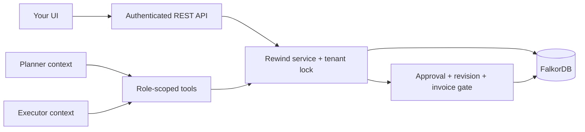

# Backend architecture and guarantees

The implementation is Python/FastAPI plus one FalkorDB 4.20.7 server. There is no UI, vector store, relational fallback, job queue, or orchestration framework. Two separately persisted tool loops share graph memory.

## State and evidence

Actual typed labels are Source, Memory, Justification, Run, Episode, Task, Action, Approval, Repair, Event, Receipt, and TenantState. Every node also has Record for indexed identity/snapshot queries. Scalar graph properties store application ID and canonical JSON data; relationships store their type and canonical metadata. Conversation/tool results are Episode nodes; event cursors are server-owned sequence numbers.

An `INPUT_TO` relationship feeds a Justification and `SUPPORTS` points to its Memory. All inputs in that justification are required. Any valid justification can ground the Memory. Cycles/self-support are rejected before writes. Admitted active sources anchor facts. Source titles, confidence, and text saying "verified" do not create trust.

Memory values/source versions are immutable. Operator correction creates a new source/fact and may supersede a withdrawn fact. Candidate agent facts are not usable until review. Plans proposed by agents must match the server's current supplier/invoice facts and cite their observed revisions. Procedures require a verified receipt, except for explicitly labeled historical demo records. Their applicability currently supports the configured workflow version and optional expiry.

`READ_BY` records which memory revision was returned to a run. Episodes preserve the exact full result history. A read indicates potential exposure; we do not claim to reconstruct hidden reasoning. Affected runs are conservatively restarted.

## Repair

The server first stores a Repair and sets TenantState to repairing. A real Cypher descendant traversal finds the affected Memory nodes. Support is recomputed from actual graph relationships with cycle protection. Unsupported memories are withdrawn; surviving alternatives remain active. The affected support revision changes, unrelated revisions remain untouched.

The repair stores baseline revisions and per-record repair IDs; retries do not repeatedly increment versions. Pending affected proposals become stale. Affected tasks advance generation and return to the planner. Existing receipts remain and receive review notices through their action.

After writing changes, the server reads the graph back and verifies affected grounding/status invariants. Only then does it mark the repair completed and reopen the tenant. Startup or the operator recovery endpoint resumes incomplete operations. Database errors never enable a fallback executor.

## Action boundary

Execution re-resolves legal name, routing, invoice amount/currency/supplier, their revisions, complete provenance, task/run generation, exact payload, and operator approval. Dependencies are server-selected; an agent cannot hide its routing dependency by omitting an ID. Facts are validated for the procurement schema. Current conflicting values cause a stop.

Receipt creation and action/task terminal updates occur in one graph write. The selected database image's failed-write rollback behavior is tested. There is no claim that separate GRAPH.QUERY calls form a transaction. The mock effect stays inside the graph so it can share the mutation boundary. Retrying the same effect returns the same receipt; another task/key cannot repay a supplier/invoice already represented by a receipt.

## Concurrency and persistence limits

Per-tenant `threading.RLock` serializes backend writes in a single process. Requests and model calls may run concurrently, but no lock is held during provider inference or human approval. Use one Uvicorn worker and one backend instance. A separate writer process against the same graph is unsupported; CLI stories require the API to be stopped. Independent test/evaluation graph namespaces are isolated.

Support evaluation currently uses bounded whole-graph snapshots (10,000 nodes, 20,000 edges), plus database traversal for repair. This is deliberate and documented; it is not a scalability benchmark. The load check uses 50 concurrent callers and 100 unique episode writes.

The official image entrypoint consumes REDIS_ARGS. Compose enables AOF with appendfsync always, mounts its actual `/var/lib/falkordb/data` directory, and exposes only loopback ports. Live configuration is checked rather than inferred from the YAML. Container restart/crash tests cover local durability; this is not a claim of disaster recovery or distributed exactly-once external effects.

## Agent modes and recovery

Live mode supports `AGENT_PROVIDER=openai` (OpenAI-compatible Chat Completions) and `AGENT_PROVIDER=codex_cli` (the supported signed-in terminal interface). Both use bounded tool loops, separate prompts, persisted messages/results, and provider usage totals. Executor pauses on proposal and receives a persisted controller approval notice on continuation. It verifies a persisted receipt before natural completion. Provider errors are sanitized; raw CLI diagnostics and account credentials are not stored in graph memory.

The Codex transport starts `codex exec` with an output schema for one tool decision, invokes no shell interpolation, removes backend identity/API keys from the child environment, ignores user config, uses an isolated working directory/read-only sandbox, and disables shell/apps/plugins/browser/computer/delegation tools. The backend validates the decision and dispatches the existing tools. Ephemeral CLI processes do not share hidden sessions; the controller restores only that Rewind run's persisted visible conversation. Account sign-in/refresh remains owned by Codex. This is a host provider, not a Windows login copied into Docker. Each CLI decision has a timeout; cancellation of the async caller can leave its worker waiting until that bounded subprocess finishes, but the worker cannot execute a Rewind effect.

Scripted mode uses the same role-scoped tool dispatcher and action gate but selects tools deterministically. It is labeled scripted in Run/Episode data. Tests also run the actual SDK against a local protocol fixture; those responses are synthetic and are not evidence of real-model quality.

Queued/running sessions interrupted by process restart are marked interrupted, with their history retained. Create fresh runs for interrupted/repaired tasks. Approval-paused runs can continue after an ordinary restart if their generation and dependencies are current. Budget exhaustion and failed work remain visible, not silently completed.

## Current limitations

An operator supplies correction authority. Rewind is not an automatic poison detector or proof of factual truth. It cannot erase stale text already in an LLM context or reverse completed external actions. MCP, cloud deployment, autonomous document extraction, general policy languages, full bitemporal queries, and distributed coordination are outside the delivered backend. The UI and final video belong to the user; endpoints and recording steps are provided.

