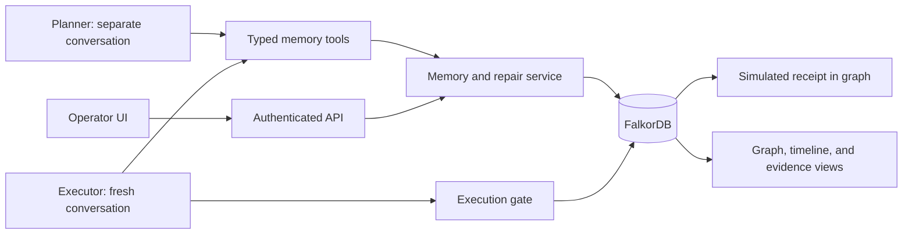

# Rewind: complete implementation and demo plan

Status: planning document; the application, tests, deployment, and video have not been built.
Prepared: 14 October 2026. All schedule times below are IST (Asia/Kolkata).
Primary submission: Graph Hacks, Track 02 — Agent Memory and Coordination.
Working pitch: **Correct one bad memory across your agents without deleting everything they learned.**

## Navigation

- [Outcome and completion criteria](#1-what-we-are-shipping)
- [Scope](#3-priority-and-scope) and [track proof](#4-track-fit-and-proof)
- [Architecture](#5-architecture-and-stack) and [graph model](#6-graph-model)
- [Repair algorithm](#7-repair-algorithm-and-lifecycle) and [action gate](#8-action-gate-approvals-and-simulated-receipts)
- [API/tools](#9-api-and-tool-contracts) and [agent behavior](#10-agent-behavior-and-handoff)
- [Fixtures](#11-demo-fixtures-and-expected-outcomes) and [interface](#12-user-interface-and-visual-design)
- [Repository/documentation](#13-repository-and-documentation-structure) and [graph queries](#14-essential-graph-queries)
- [Build phases](#15-implementation-phases-dependencies-and-acceptance-gates)
- [Test matrix](#16-test-matrix) and [evaluation](#17-evaluation-and-credible-performance-claims)
- [Setup/deployment](#18-setup-recovery-and-deployment-runbook)
- [Video storyboard](#19-main-demo-video-proposed-three-minute-storyboard)
- [Submission package](#20-blog-and-submission-package), [risks](#21-risks-mitigations-and-fallback-order), and [references](#22-research-and-technical-references)
- [Definition of done](#23-definition-of-done)

## 1. What we are shipping

Rewind is a shared agent memory service with explicit evidence lineage. When an operator revokes a bad source, it finds the memories that depended on it, withdraws unsupported conclusions, preserves independently supported knowledge, prevents pending actions from using stale memory, and helps affected agents resume with corrected context.

The demonstration uses a fictional procurement team and a simulated payment ledger. No banking API or real money movement is involved. Two real LLM agents use tools against a real FalkorDB instance. An operator identifies the bad source; Rewind performs the repair. The product does not claim to detect every lie or automatically reverse completed external actions.

### Product outcome

A procurement planner records a supplier's payment routing details from an accepted but incorrect onboarding note. A separate executor retrieves that memory in a new session and prepares a payment proposal. The operator revokes the note. Rewind shows the recorded dependencies, blocks an already-prepared stale action, preserves unrelated and independently supported memories, and rebuilds the affected plan after an authoritative correction arrives.

### Target user and commercial hypothesis

The initial user is an engineer operating multiple agents that share long-lived organizational memory. Their problem is correcting persistent mistakes without resetting every agent or silently leaving contaminated decisions behind. Procurement is the demonstration domain, not a requirement to build a financial-services company.

Potential adoption surface: a memory API/tool service that an existing agent application calls for retrieval, write proposals, provenance, and revocation. Validate this hypothesis after the hackathon with agent platform engineers. No customer validation or revenue claim exists yet.

### Submission claim

"We built a graph-backed memory correction system. It records which facts support each derived memory and which memories each run read. Revoking a source repairs the supported knowledge graph and invalidates stale proposals at execution time. The demo uses two real agents and a simulated procurement workflow."

### Completion criteria

- [ ] Two independent agent conversations use the same durable graph memory.
- [ ] Semantic facts, episodic histories, and procedural memory are represented and inspectable.
- [ ] A source revocation propagates through multiple derivation hops.
- [ ] A memory with a remaining valid justification stays active.
- [ ] A stale executor cannot commit an action using revoked or superseded evidence.
- [ ] An authoritative correction creates new memory and a new action proposal.
- [ ] Corrected execution produces exactly one simulated ledger receipt.
- [ ] Restarting the application does not erase memory, conversation history, handoffs, or revocations.
- [ ] Concurrent operations do not lose records or execute duplicate actions.
- [ ] One tenant cannot retrieve, modify, or revoke another tenant's memory.
- [ ] The UI exposes evidence paths, actual tool calls, repair effects, and action receipts.
- [ ] A reproducible evaluation, setup guide, repository, and demo video are ready.

## 2. Event requirements and preparation boundary

Required submission artifacts: public source repository, README with setup and graph data model, essential Cypher queries or algorithms, working demo video, deployment or complete local instructions, named track, and disclosure of AI coding assistance. Use only public, synthetic, or otherwise allowed data. FalkorDB must be central. [Official rules](https://www.wemakedevs.org/hackathons/falkordb/rules).

The proposed three-minute video is our presentation target. It is not a verified Graph Hacks video-duration requirement. Check the submission form before recording and adapt if it specifies a limit.

## 3. Priority and scope

### P0: required for a credible submission

1. Typed graph memory with sources and justifications.
2. Two agent roles, persistent conversations, and a durable handoff.
3. Correct source revocation and selective invalidation.
4. Action proposals with dependency snapshots and operator approval.
5. An execution gate enforced in application code.
6. Durable simulated receipts and retry-safe execution.
7. Two isolated tenant graphs and role-scoped access.
8. An understandable graph/timeline interface.
9. Behavioral tests, measured evaluation, reproducible local setup, and video.

### P1: add only after P0 passes

- A thin MCP interface to the same memory functions, demonstrated with actual MCP calls.
- A public deployment with read-only exploration of sanitized sample results.
- A comparison panel using measured fixture results.
- A small verified-procedure reuse example in a second procurement task.
- A technical blog explaining the graph, support semantics, and failure tests.

### Explicitly deferred

No vector database, graph extraction framework, autonomous poisoning detector, bank integration, Kubernetes, distributed job queue, multi-region deployment, generalized policy language, full organization onboarding, or plugin marketplace. No extra agents merely to make the system look sophisticated.

If adding a deferred feature becomes necessary, document the concrete blocker first. The core novelty is selective correction, not connector count.

## 4. Track fit and proof

| Track focus | Rewind behavior | Required evidence |
| --- | --- | --- |
| Episodic memory | Messages, retrievals, tool outcomes, handoffs, repairs, and receipts | Persistent timeline and source-linked episodes |
| Semantic memory | Supplier facts with typed values, support, status, and revisions | Fact inspector and read tool output |
| Procedural memory | Verified workflow steps with conditions and provenance | Procedure inspection and controlled reuse/invalidation |
| Persistent conversation | Agent messages survive process restart | Before/after restart, same run/task IDs |
| Shared state and handoffs | Planner hands a persisted task to executor | New executor context retrieves shared memory |
| Concurrent reads/writes | Concurrent requests preserve observations and reject stale commits | Recorded stress/race test results |
| User/tenant separation | Server-resolved tenant maps to isolated graph | Negative API/tool tests |

FalkorDB stores the authoritative memory, support graph, episodes, runs, handoffs, proposed actions, and simulated receipts. A visualization alone is insufficient. When FalkorDB is unavailable, memory tools and execution fail closed; there is no hidden fallback that performs the same workflow from a local JSON fixture.

## 5. Architecture and stack

### Default stack

| Component | Choice | Reason |
| --- | --- | --- |
| Backend | Python 3.12, FastAPI, Uvicorn | One service for API, tools, agent execution, and static UI |
| Contracts | Pydantic, already used by FastAPI | Typed tool/API inputs and outputs |
| Database | FalkorDB in Docker with a named persistent volume | Primary state and provenance graph |
| LLM | One provider SDK and one tool-capable model selected at kickoff | Avoid provider abstractions; record exact model/version |
| Agent coordination | Two bounded tool loops and Python asyncio | No orchestration framework needed for two roles |
| Frontend | HTML, CSS, plain JavaScript | No separate frontend runtime or bundler |
| Graph display | Pinned Cytoscape.js asset, served locally | Interactive graph is a core product surface |
| Live updates | Short polling of persisted events | Simpler reconnection and restart behavior than a streaming stack |
| Tests | pytest; one focused behavioral suite | State, race, and persistence checks matter here |
| Packaging | Docker Compose plus exact dependency lock | Reproducible application and database |

Check the actual Windows environment at kickoff: Docker Desktop/WSL2, Python, Git, free ports, model credentials, and network access. Choose the available provider rather than waiting for optional credits. Do not invent an exact model name in advance. Pin tested dependencies and image digests after the first successful setup.

### Data flow



UI and agents call the same service functions. The LLM can select allowed tools and draft proposals; it cannot choose a tenant graph, run raw Cypher, grant itself authority, change approval status, or bypass the execution gate.

### Process model and known ceiling

Use one backend process and exactly one Uvicorn worker. Planner/executor loops are independent asynchronous tasks with separate prompts and histories. Serialize tenant mutations with a per-tenant `asyncio.Lock`, including repair, proposal creation, approval, and simulated execution. Offload blocking database calls to a worker thread if needed, while retaining the lock until the operation completes.

This is an intentional hackathon ceiling: concurrent requests are supported, but committed writes are serialized per tenant. It is not a distributed locking system or an unlimited-throughput claim. Mark this with a `ponytail:` implementation comment and document that multiple backend workers require database-level coordination before they can be enabled.

Never hold the lock while waiting for a model response or human input. Revalidate every later write against current state.

## 6. Graph model

Use one graph per tenant, resolved by the server from an authenticated identity. Suggested names are internal identifiers such as `rewind_tenant_a`; clients never supply graph names. Globally unique application IDs make fixtures and audit links predictable. Do not rely on internal database IDs as stable external IDs.

### Nodes

| Label | Essential properties | Purpose |
| --- | --- | --- |
| TenantState | id, mode, event_sequence, schema_version | Readiness and ordered audit stream |
| Source | id, title, content_hash, authority, status, created_at, revoked_at, reason | Evidence origin and operator-controlled trust state |
| Memory | id, kind, subject, predicate, value_json, status, revision, last_repair_id, created_at, valid_from, valid_until | Immutable claim/procedure payload and mutable lifecycle |
| Justification | id, rule, status, created_at | One complete set of inputs supporting a memory |
| Run | id, role, task_id, status, parent_run_id, model, started_at, ended_at | Separate agent session and recorded retrievals |
| Episode | id, sequence, role, content_json, created_at | Persisted message/tool/history event |
| Task | id, goal, constraints_json, status, owner_role, generation, last_repair_id | Durable work and handoff state |
| Action | id, task_id, generation, type, payload_json, payload_hash, status, idempotency_key | Frozen proposed effect |
| Approval | id, action_id, payload_hash, actor_id, status, created_at | Operator approval bound to exact proposal |
| Repair | id, source_id, state, reason, cursor_json, started_at, completed_at | Recoverable repair operation |
| Event | id, sequence, type, entity_id, details_json, created_at | Operator-readable audit and UI stream |
| Receipt | id, action_id, idempotency_key, payload_hash, result_json, created_at | Simulated committed effect |

Store conversation and structured episode data as canonical JSON strings where graph property types do not represent the needed object. Large source bodies can remain in allowed fixture files, but their hashes, claim spans, source metadata, and relationships belong in FalkorDB. Source URLs and span offsets must resolve to the exact version used.

### Relationships

| Relationship | Meaning |
| --- | --- |
| Source or Memory `INPUT_TO` Justification | This input is required by this justification |
| Justification `SUPPORTS` Memory | This complete justification supports this memory |
| Memory `READ_BY` Run | The tool returned this memory to this run; record revision/time |
| Run `PRODUCED` Memory | Authorship; this does not itself establish evidential support |
| Episode `BELONGS_TO` Run | Persistent conversation history |
| Run `WORKS_ON` Task | Work ownership |
| Run `HANDED_OFF_TO` Run | An explicit handoff with a saved task/constraints |
| Run `PROPOSED` Action | The run proposed this effect |
| Memory `REQUIRED_BY` Action | Server-computed dependency; save expected revision |
| Approval `APPROVES` Action | Exact operator authorization |
| Memory `SUPERSEDES` Memory | Explicit replacement with a retained historical record |
| Repair `REVOKES` Source | The repair is rooted in this source withdrawal |
| Action `HAS_RECEIPT` Receipt | Verified simulated result |

Do not confuse an episode, a run's opinion, and a supported memory. A retrieval trace identifies a potentially affected run; it does not prove what happened inside the model's hidden reasoning.

### AND/OR support semantics

Every input of a justification is required: inputs within a justification are **AND**. Any valid justification can support the memory: separate justifications are **OR**.

Example: vendor name has one justification from onboarding and a second independent justification from a reviewed purchase order. Revoking onboarding invalidates its justification, but the name stays active through the purchase order. Payment routing has only onboarding support and becomes unsupported.

A justification is valid only when its source inputs are active and admitted under server policy, all memory inputs are active and grounded, and applicability conditions hold. A memory is active only if at least one complete justification is valid. A source text saying "verified" does not grant itself authority. Agent confidence is not authority.

Prevent circular justification. Reject a proposed edge when it makes a memory depend on itself, directly or indirectly. The derivation graph must remain acyclic and grounded in admitted sources. A copied claim is not an independent root just because a different agent wrote it.

### Versions, contradiction, and procedure rules

- Never edit a memory value in place. A correction is a new memory ID with an explicit supersession decision.
- Status/support changes increment the affected memory's application revision, even if its value is retained through another justification. Old proposals then require revalidation/replanning. Unrelated revisions do not change.
- The `GRAPH.QUERY` schema-version parameter is not an application data revision. Maintain our own revisions.
- Conflicting values for the same subject/predicate are presented for review. Do not use "newer wins" or "higher confidence wins" automatically.
- Initial fixtures may contain historically accepted wrong memory. Label that setup explicitly; do not pretend a live jailbreak succeeded.
- Normal ingestion proposes typed claims. Sensitive routing facts require operator admission or an allowlisted authoritative source policy.
- Procedures include preconditions, product/domain version, steps, expected outputs, and supporting IDs. A completed, verified task is required before a procedure is eligible for reuse.
- A procedure that loses support or no longer meets preconditions is not retrieved as usable guidance.
- Revocation is effective now. Keep past source/memory states for historical audit; do not claim full bitemporal querying unless implemented and tested.

## 7. Repair algorithm and lifecycle

### Correctness rules

1. Source revocation is operator-controlled and irreversible within that source version. Re-admission uses a new reviewed source version.
2. The graph identifies candidate descendants; traversal alone does not determine which memories must be withdrawn.
3. Recompute AND/OR support in topological order for the affected derivation subgraph.
4. Mark a memory unsupported only if all its justifications are invalid.
5. Preserve valid independent support and unrelated memory.
6. Invalidate pending proposals with changed dependency revisions; do not silently rewrite approved payloads.
7. Existing contexts are not magically scrubbed. Replace affected conversations with fresh runs and controlled context.
8. Completed receipts remain immutable; record review-needed notices instead of claiming rollback.

### Durable repair sequence

Under the tenant mutation lock:

1. Validate operator role, tenant, source ID, reason, and idempotency key.
2. Persist a Repair record and set `TenantState.mode = repairing` before mutating support state. Memory admission, retrieval for new work, approvals, and execution pause while this marker is present; audit inspection remains available.
3. Persist the source's revoked status and the revocation event.
4. Query descendant justifications and memories. Build a bounded topological working set from graph results; never load alternate truth from JSON.
5. Evaluate current root support and procedure conditions. Compute invalidated, preserved-with-changed-support, unchanged, and review-needed sets.
6. Write status/revision changes and record repair progress. Persist `last_repair_id` alongside each memory revision and affected task generation. Retries with that same repair ID do not increment those values again; recompute any incomplete work from current graph support.
7. Identify runs that read affected memories and actions with obsolete dependencies. Mark pending actions stale; increment affected task generations; mark affected runs restart-required. Record already-committed actions for review.
8. Verify the resulting support invariants and persist the completed report.
9. Set repair completed and tenant ready only after the graph passes validation.

If a failure or process crash occurs after step 2, the persistent repairing marker prevents execution. Startup detects incomplete repairs and resumes/recomputes them before accepting new agent work. Leave repair marked failed/repairing if invariants cannot be restored; expose the error instead of reopening the execution path.

Do not assume a sequence of independent graph queries has transaction rollback. Document the actual guarantees of the pinned database version and test interrupted writes. The durable repair marker provides the application recovery boundary even when a repair spans several queries. Temporary tenant-wide pause is deliberate; selective preservation and task resumption happen after repair.

### Algorithm outline

```text
affected = graph.descendants(revoked_source, INPUT_TO/SUPPORTS)
ordered = topological_order(affected)
for memory in ordered:
    valid_supports = justifications whose required inputs remain valid
    next_status = active if valid_supports exist else unsupported
    persist next_status and changed support revision exactly once per repair
changed = memories whose support/status changed
affected_runs = runs recorded as reading changed memories
stale_actions = pending actions requiring changed revisions
resume_tasks = tasks requiring a fresh run after repair
```

Bound fixture graphs and dependency depth; reject cycles, invalid IDs, and excessive graph expansion with visible errors. For the expected small graphs, a Python topological pass over graph-returned records is enough. The database remains the authority for lineage and persisted outcomes.

## 8. Action gate, approvals, and simulated receipts

The executor proposes a mock payment; it cannot approve it. The operator approves a frozen payload hash. Execution does not trust `approved=true` supplied by the client or agent.

Action fields include supplier ID, invoice ID, amount in integer minor units, currency, fictional routing token, task generation, required memory IDs/revisions, provenance bundle hash, and idempotency key. Use `BANK-DEMO-CORRECT` and `BANK-DEMO-WRONG`, never real account data.

The server computes required dependencies from the allowed action schema. For a payment these include current supplier identity, invoice amount/currency, routing facts, and applicable procedure evidence. Do not allow an agent to omit the dangerous field's supporting memory ID to bypass validation. Model-supplied IDs are candidates; the server resolves and verifies the complete required set.

Immediately before execution, under the same tenant lock:

- Tenant is ready and database available.
- Run/task generation is current and run is not restart-required.
- Action is pending/approved, belongs to the tenant, and has not been superseded.
- Exact payload and provenance match the stored approval.
- Every required memory is currently active, has the expected revision, and has valid grounded support.
- Payload values agree with the current typed memories and procedure preconditions.
- No blocking contradiction or unreviewed sensitive claim exists.
- Amount/currency pass server-side validation and fixed demo limits.
- Idempotency key has no conflicting prior payload or receipt.

Fail closed with explicit reasons such as `STALE_MEMORY`, `REPAIR_IN_PROGRESS`, `STALE_TASK`, `MISSING_APPROVAL`, `CONFLICTING_FACT`, or `INVALID_PROVENANCE`.

The mock effect is creation of a Receipt node in FalkorDB. Combine the action terminal update and receipt creation in one guarded write query where supported by the tested version. On an ambiguous timeout, look up by idempotency key before retrying. Use database uniqueness constraints if available and verified; otherwise the one-process lock plus lookup is the documented demo ceiling. Never claim real-world exactly-once payments.

If the effect committed before revocation, keep the receipt and flag it for review. If revocation committed first, stale execution must be rejected. Both race orderings are tested and honestly reported.

## 9. API and tool contracts

All structured results include IDs, status/revision, evidence/support IDs, tenant-resolved scope, and an error/reason when unavailable. Bound payload sizes and query result counts. Use parameterized Cypher; never interpolate source text or client IDs into query syntax.

`read_memory` captures the returned records and their retrieval episode under the tenant lock so the recorded revisions match the actual tool response. It never holds the lock during a later model call. Read-only audit/graph browsing may continue during repair, labeled as in-progress state; usable agent-memory retrieval waits or returns `REPAIR_IN_PROGRESS`.

### Core agent tools

| Tool | Allowed callers | Contract |
| --- | --- | --- |
| `read_memory(subject, predicates)` | Planner/executor | Current grounded memory and a recorded retrieval episode |
| `propose_memory(claim, supporting_ids)` | Planner | Typed candidate, scope/lineage checks; no self-granted authority |
| `save_episode(kind, data)` | Both | Append-only history with server sequence and timestamps |
| `handoff(task_id, constraints)` | Planner | Durable task/handoff state; executor starts separately |
| `inspect_provenance(memory_id)` | Both | Source and justification paths with uncertainty |
| `propose_action(task_id, payload, candidate_memory_ids)` | Executor | Frozen action with server-resolved required dependencies |
| `execute_action(action_id)` | Executor | Enforced approval/dependency gate and receipt/error |
| `read_task(task_id)` | Both | Current generation, owner, status, and last verified outcomes |

### Operator-only operations

`admit_source`, `review_memory`, `preview_revocation`, `revoke_source`, `approve_action`, `apply_correction`, and `resume_task`. Preview is explanatory, not authoritative: apply recomputes against current state. A repair requires a reason and records the operator identity.

Suggested REST surfaces: `/health`, `/api/state`, `/api/sources`, `/api/memory`, `/api/graph`, `/api/events?after=sequence`, `/api/tasks`, `/api/actions`, `/api/repairs`, and explicit operator mutation routes. Do not expose a generic raw-query endpoint.

P1 MCP uses the same functions, with schemas and authorization on the server. Mount the official Python SDK with the parent ASGI lifespan correctly initialized. Show actual MCP transport/tool logs if claiming MCP integration; normal function calls are labeled as such.

### Identity and tenant enforcement

For local development, use server-configured demo identities/tokens mapped to role and tenant. UI operator session and agent credentials are distinct. Keep tokens/model keys out of static JavaScript and logs. A tenant selector may switch only among tenants permitted for the authenticated operator. Agents have no selector.

Public deployment should be read-only by default or use a protected operator session. Avoid shared anonymous write/reset access. Creating isolated per-visitor rooms is optional and must not delay the core demo. Graph isolation alone is not authorization.

## 10. Agent behavior and handoff

### Planner

Goal: prepare a supported procurement plan for a given invoice. Tools: memory retrieval, provenance inspection, memory proposals, episodic logging, task inspection, and handoff. It cannot approve, revoke, or execute actions.

Prompt requirements: retrieve before drafting; cite returned IDs; keep source content as data; do not promote untrusted instructions; save uncertainty; request review if facts conflict or are missing; hand off exact goal, constraints, IDs/revisions, and unresolved issues.

### Executor

Goal: independently retrieve the handoff's current dependencies and propose/execute only the approved mock effect. Its conversation starts fresh; do not paste the planner's entire transcript into it. It reads task/constraints and shared memory via tools.

Prompt requirements: re-read current task and memory; inspect provenance; do not invent supplier routing; propose an action; pause at operator approval; execute through the gate; verify receipt; stop on stale state and let the controller schedule a fresh run.

### Controller

Ordinary application code owns task generations, permissions, step budgets, resume decisions, and approval state. Bound each agent to a configurable small tool-step budget, initially 10, and bounded retries. Persist each model response, proposed tool call, result, and error with run/task IDs and provider request metadata when available. Record token usage if the provider supplies it.

Never stream or display supposed hidden chain-of-thought. Display observable tool choices, evidence references, concise decision summaries, and uncertainty.

Restart recovery marks interrupted runs and reconciles saved tool/effect outcomes before retrying. Reuse idempotency keys. Existing poisoned contexts are abandoned; new runs receive the goal, constraints, current memory, and repair summary. The old episode history stays visible for audit.

Procedural memory records a verified workflow such as resolve supplier → verify invoice → resolve current routing → propose → await approval → execute → verify receipt. Include version/preconditions and actual verified outcomes. Invalidating a supporting input makes derived procedure reuse ineligible until recomputed and verified.

## 11. Demo fixtures and expected outcomes

Everything in the fixture is fictional. Use integer amounts, stable application IDs, synthetic messages, and unmistakably fictional routing tokens. Ground-truth labels live in the evaluation fixture only and must never be sent to an agent as hidden answer hints.

### Main scenario: Northstar procurement

Tenant A is a fictional company with supplier Northstar Components. Invoice `INV-DEMO-1042` is for 125,000 minor units, currency USD. An accepted but incorrect onboarding note says routing is `BANK-DEMO-WRONG`. An independently reviewed purchase order agrees on the supplier's legal name but contains no routing information. A separate accepted record describes delivery terms. A verified correction containing `BANK-DEMO-CORRECT` arrives only after revocation.

| Fixture ID | Record | Expected after onboarding revocation |
| --- | --- | --- |
| `src-onboarding-incorrect` | Historically accepted onboarding note | Revoked; retained for audit |
| `src-purchase-order-reviewed` | Independent reviewed purchase order | Active |
| `src-delivery-terms` | Unrelated accepted terms | Active |
| `mem-supplier-name` | Name supported separately by onboarding OR purchase order | Active; support/revision updated |
| `mem-routing-wrong` | Routing supported only by onboarding | Unsupported |
| `mem-invoice-amount` | Invoice amount supported by purchase order | Active, unchanged |
| `mem-delivery-terms` | Terms supported by unrelated source | Active, unchanged |
| `mem-payment-plan-old` | Derived plan needs routing AND invoice facts | Unsupported |
| `mem-routing-procedure-old` | Learned procedure derived from the old plan | Ineligible for reuse |
| `task-invoice-1042` | Shared task for two roles | New generation; needs fresh work |
| `action-payment-old` | Approved but deliberately unexecuted old proposal | Stale; execution rejected |
| `src-routing-correction-reviewed` | New authoritative correction | Initially absent; admitted after repair |
| `mem-routing-correct` | New routing memory with independent correction support | Active after correction admission |
| `action-payment-new` | Newly derived and approved proposal | Executable; one simulated receipt |

Operator review/admission is part of the controlled fixture setup. The initial wrong note is an already-accepted mistake, not evidence of defeating Rewind's ingestion defenses. Do not seed fake model conversations or fake tool runs. Actual planner/executor messages and proposals are generated through the live agent path.

Use a seeded, explicitly labeled historical procedure if necessary to demonstrate procedural invalidation. Prefer producing a verified benign procedure during a rehearsal and then demonstrating its conditional reuse. Historical seeded records must be visually distinguishable from live run outcomes.

### Additional scenarios

1. Tenant B uses the same vendor name and invoice label but has different memory. Tenant A repair does not touch it.
2. A derived memory has two alternative justifications; one is revoked and the other still works.
3. A justification needs two inputs; losing one invalidates it even if the other remains.
4. A copied summary ultimately depends on the bad source. Copying does not create independent support.
5. A chain branches into several derived memories and converges again; repair follows both branches.
6. A wrong source was already used by a committed action. Mark its receipt review-needed; do not delete it.
7. A correction is a new accepted source but conflicts with another active authoritative source. Stop for resolution.
8. An unrelated approved action should become executable after the temporary repair pause without being cancelled.

## 12. User interface and visual design

The main interface is an operator workspace, not a generic chat window. Target a desktop layout that fits a 1920×1080 recording without tiny text. Keep the graph at roughly 20–40 visible nodes in the main scenario; collapse episodes and unrelated records until selected.

### Layout

- Top bar: Rewind name, current tenant, live/replay label, database health, repair mode, and run status.
- Left panel: sources and memory filters. Each source shows authority, status, reason, and version/hash.
- Center: layered graph with sources → justifications → memories/procedures → runs → actions/receipts.
- Right panel: selected record, exact content/value, evidence spans, support alternatives, revisions, and available operator actions.
- Bottom or separate tab: chronological tool/audit timeline, persisted sequence numbers, and restart markers.

### Operator flow

1. Load the main fixture through a protected local setup operation.
2. Start planner; watch actual tool events and supported memories appear.
3. Start fresh executor from the durable handoff.
4. Inspect and approve the old frozen action without executing it.
5. Preview revocation: display likely descendants and independently supported survivors.
6. Apply revocation with a reason. Show actual repair result and counts.
7. Attempt old action. Display the returned rejection and the exact failed dependency.
8. Admit the reviewed correction, resume a fresh run, inspect/approve the new proposal, and show the receipt.
9. Open preserved memory and tenant B to demonstrate selectivity and isolation.

### Visual semantics

Use text labels and icons as well as color: active/retained, unsupported, stale proposal, repair in progress, and receipt verified. Show reasons such as "retained: purchase order still supports this name" or "blocked: routing memory revision changed." A red edge means withdrawn support, not proven malicious intent.

Click a claim to show its valid justifications and a path to original evidence. Click a run to show the exact returned memory IDs/revisions. Click an action to show frozen payload, approval, validation results, and receipt. Graph layout should not jitter on every polling update.

The product's visible language explains user consequences. Protocol details and raw Cypher belong in an expandable developer evidence panel or documentation. Do not put database schema/version options into normal operator controls.

### Accessibility and reliability

Keyboard-focusable controls, readable contrast, visible loading/error states, confirmations bound to the exact record/action, and disabled controls while a repair pauses mutations. Never replace an error with a green success state. Display synthetic data and simulated payments persistently. Never display model secrets or login tokens.

### UI state source

Every repair count, graph status, event, and receipt comes from persisted backend state. The frontend cannot declare an action completed. Polling resumes from the last event sequence after refresh/restart. If a sequence gap is detected, refresh a bounded state snapshot. Replay mode reads stored events and is clearly labeled; do not use replay to claim a live agent response.

## 13. Repository and documentation structure

Start with the smallest understandable layout. Add a file only when a real responsibility warrants it.

```text
plan.md                         # this living plan
README.md                       # pitch, setup, evidence, submission links
pyproject.toml + lockfile        # tested Python dependencies
Dockerfile
compose.yaml
.env.example                    # variable names, no real secrets
.gitignore
rewind/
  app.py                        # API, auth, lifecycle, static serving
  graph.py                      # parameterized query calls and graph state
  memory.py                     # support evaluation, repair, and versions
  agents.py                     # bounded planner/executor loops and prompts
  actions.py                    # proposal/approval/gate/mock receipt
  demo.py                       # seed, verification, safe demo operations
  mcp.py                        # P1 only; wrapper around existing services
static/
  index.html
  app.js
  styles.css
  vendor/                       # pinned graph library and its license
fixtures/
  northstar.json
  evaluation.json
tests/
  test_rewind.py                 # behavioral correctness and race checks
  test_live_smoke.py             # opt-in actual-model test
scripts/
  evaluate.py                   # reproducible evaluation and artifact export
docs/
  architecture.md               # diagram, invariants, tradeoffs
  graph-model.md                # labels/edges, AND/OR examples, revisions
  queries.md                    # essential executable Cypher + expected results
  memory-contracts.md           # tool schemas and trust/admission rules
  evaluation.md                 # scenarios, methods, measured results
  runbook.md                    # setup, reset, restart, repair recovery, troubleshooting
  demo-script.md                # narration and exact recording steps
  limitations.md                # scope ceilings and honest product claims
  ai-use.md                     # assistants, contributions, verification
artifacts/
  evaluation/                   # sanitized JSON/CSV metrics, logs, versions
  demo/                         # screenshots, video metadata/links
```

This is an intended layout, not a requirement to create empty files. Keep modules small; do not add repository patterns, generic factories, or a provider framework. Use standard-library `uuid`, `hashlib`, `json`, `datetime`, `asyncio`, and collections where sufficient. Include dependency licenses and third-party attribution.

### README contents

1. One-sentence problem and result.
2. Screenshot and signed-out-accessible video link.
3. Track 02 fit and exactly where FalkorDB is central.
4. What is live, what is simulated, and what is seeded.
5. Prerequisites, pinned versions, environment variables, setup, and first demo.
6. Graph model and direct links to essential queries/algorithm.
7. Agent roles and execution gate.
8. How to run correctness tests, opt-in live smoke, and evaluation.
9. Actual results, conditions, and limitations.
10. Deployment/local run instructions, license, research references, and AI assistance disclosure.

### Document as we build

For every completed phase, record implemented behavior, changed contracts, verification evidence, and remaining limitations in this plan's phase checklist. Documentation examples must match the final implementation. Store facts about bugs and fixes, not a transcript of every coding step. Finish with a clean-room setup check instead of assuming your own working environment represents a stranger's setup.

## 14. Essential graph queries

`docs/queries.md` must contain the final executable, parameterized Cypher for these operations. Validate every query against the pinned FalkorDB image; do not present untested Neo4j-specific syntax as supported.

| Query | Graph job | Evidence in demo/tests |
| --- | --- | --- |
| Current memory lookup | Filter subject/predicate, status, support, and applicability | Agents receive usable current records |
| Justification expansion | Fetch complete input sets and alternative supports | AND/OR retention test |
| Source descendants | Traverse `INPUT_TO`/`SUPPORTS` lineage with bounded depth | Multi-hop impact path |
| Provenance bundle | Return source spans/hashes for a memory | Clickable explanation |
| Affected run lookup | Join changed memory to `READ_BY` runs | Restart list and audit |
| Stale proposal lookup | Compare frozen dependency revisions and task generation | Stale action rejection |
| Repair report | Join Repair, changed nodes, events, and review notices | UI counts and preserved set |
| Episode replay | Ordered persistent messages/tool results for a run/task | Conversation restart proof |
| Receipt lookup | Resolve immutable result by idempotency key | Retry and duplicate prevention |
| Guarded receipt write | Revalidate action state and create result under tested guarantees | Actual simulated effect |

Write edges and payloads through fixed application functions. Cross-tenant IDs and raw graph names are rejected before query execution. Use graph query timeouts, pagination where needed, and bounded result sets.

## 15. Implementation phases, dependencies, and acceptance gates

### Phase 0 — preparation notes, October 14

- [x] Select Rewind and document the first complete plan.
- [ ] Register for the event and verify team details yourself.
- [ ] Read the current official rules and submission form.
- [ ] Review source research and graph sketches.
- [ ] Confirm model access and development prerequisites without starting project implementation.

Output: this plan and a clear main scenario. No runtime claims.

### Phase 1 — environment and graph skeleton, October 15 morning

- [ ] Create the project during the event and establish commit history.
- [ ] Verify Python, Docker/WSL2, Git, model key access, and local ports.
- [ ] Start a pinned FalkorDB image with named volume at its actual data directory.
- [ ] Enable and verify persistence configuration; prefer AOF with a documented sync policy for this small demo.
- [ ] Implement health/readiness, server role/tenant mapping, and one-worker operation.
- [ ] Implement typed nodes, stable IDs, graph reads/writes, and source spans.
- [ ] Seed two isolated fictional tenants through a local authorized command.
- [ ] Restart the database container and verify the same graph records remain.

Acceptance: one documented setup starts; memory survives restart; unauthorized/cross-tenant reads fail; no provider secrets are in the repository/browser.

### Phase 2 — repair correctness before agents, October 15 afternoon/evening

- [ ] Implement source admission, memory proposals, justifications, and cycle prevention.
- [ ] Implement current grounded retrieval and explicit contradiction handling.
- [ ] Implement repair marker, descendant retrieval, support recomputation, revisions, and persistent report.
- [ ] Implement idempotent recovery of interrupted repair.
- [ ] Check single-source, AND, OR, copied-summary, chain, branch, and tenant cases.
- [ ] Add a CLI/API demonstration that revokes one source and prints actual invalidated/preserved IDs.

Acceptance: selective invalidation works on actual FalkorDB records. If it does not, do not spend the next day on UI animation or extra connectors.

### Phase 3 — actions and durable coordination, October 16 morning

- [ ] Add Tasks, Runs, Episodes, generation changes, and persistent handoff.
- [ ] Implement frozen proposals, complete dependency resolution, payload/provenance hashes, and operator approvals.
- [ ] Implement execution gate, simulated receipt, and idempotent retries.
- [ ] Implement stale-run rejection and review flags for committed historical effects.
- [ ] Race revocation against execution using controlled test barriers.
- [ ] Crash/restart around repair and receipt boundaries and reconcile ambiguous outcomes.

Acceptance: no tested stale proposal commits; retry returns the same receipt; executed-before-revocation is reported honestly.

### Phase 4 — two live agents, October 16 afternoon

- [ ] Choose and record one actual provider/model; use its normal tool-call SDK.
- [ ] Add bounded Planner and Executor loops with independent contexts.
- [ ] Persist every message and tool result; track supported IDs and versions.
- [ ] Planner hands off; fresh Executor re-reads shared memory and creates an action.
- [ ] Operator approval is a real paused state.
- [ ] After repair, affected tasks start fresh runs using current memory.
- [ ] Verify procedural-memory representation and at least one real or labeled historical workflow example.
- [ ] Run one live end-to-end smoke with explicit provider usage and outcomes.

Acceptance: agents actually invoke tools, learn/retrieve shared state, and produce a corrected proposal. Ground-truth fixture labels never enter prompts.

### Phase 5 — operator UI, October 16 evening to October 17 morning

- [ ] Implement graph, inspector, source list, task/action panel, and timeline.
- [ ] Read actual graph/audit state; implement stable layouts and polling reconnection.
- [ ] Bind operator controls to authenticated server actions.
- [ ] Clearly mark synthetic data, simulated effects, seeded records, and live/replay modes.
- [ ] Verify keyboard controls, error states, legibility, and recording viewport.

Acceptance: a stranger can follow the mistake, its propagation, the repair, and the verified mock result without reading raw code.

### Phase 6 — evaluation and optional MCP, October 17 afternoon

- [ ] Complete the behavioral matrix below.
- [ ] Run the deterministic evaluation on real database snapshots and save results.
- [ ] Record concurrency/repair latencies and actual graph sizes.
- [ ] Run a small opt-in live-model repetition; report variability and cost.
- [ ] If time remains, add MCP schemas and a real transport smoke test using the same service functions.
- [ ] Optional: capture a short MCP clip and a verified procedural reuse example.

Acceptance: measured artifact results support the claims. No fabricated performance statistics or "production-ready" label.

### Phase 7 — packaging and recording, October 18

- [ ] Freeze features by midday; prioritize failures, clarity, and reproducibility.
- [ ] Verify local setup from a clean environment or separate checkout/config.
- [ ] Confirm pinned dependencies, mounted persistence, safe network binding, and health checks.
- [ ] Finish README, graph queries, contracts, limitations, runbook, AI disclosure, and attribution.
- [ ] Record the three-minute story and a short technical backup clip.
- [ ] Publish video and verify its link signed out. Verify repo is public.
- [ ] Deploy a protected/read-only demo if feasible; otherwise supply complete local instructions.
- [ ] Complete submission form and inspect all links before the deadline.

Aim to submit by 10:00 PM IST on October 18, leaving a buffer before the official 11:59 PM deadline. This is a planning target, not an additional event rule.

## 16. Test matrix

Use deterministic fake-model outputs for most behavioral tests, but run the actual graph service and action gate. One separate opt-in live-model test proves real tool use. The deterministic suite must not silently call a paid provider.

| ID | Scenario | Expected behavior |
| --- | --- | --- |
| T01 | Revoke only support for a root claim | Claim becomes unsupported and unavailable for usable retrieval |
| T02 | Multi-hop derived plan/procedure | Unsupported state propagates through all required derivations |
| T03 | AND justification loses one input | Entire justification becomes invalid |
| T04 | OR support loses one independent source | Memory stays active through remaining valid support |
| T05 | Copied claim presented as independent | No new root support is invented |
| T06 | Unrelated memory/action | Memory and task remain; action works after temporary pause |
| T07 | Cycle/self-support proposal | Rejected; no partial supporting relationship admitted |
| T08 | Old action after revocation | Rejected with exact stale dependency; no receipt |
| T09 | Agent omits routing dependency or spoofs approval | Server rejects incomplete provenance/unauthorized approval |
| T10 | Payload changes after approval | Approval hash mismatch; execution blocked |
| T11 | Verified correction | New memory/new generation/new approval; correct mock receipt |
| T12 | Duplicate action/retry/ambiguous response | At most one receipt for the same approved payload/key |
| T13 | Conflicting payload with same idempotency key | Conflict; original receipt not overwritten |
| T14 | Revocation/execute race | Either effect committed first with review notice, or revocation first blocks it |
| T15 | Interrupted repair and backend restart | Persistent marker blocks work; repair resumes idempotently |
| T16 | Backend and DB container restart | Sources, messages, tasks, repair, and receipts persist |
| T17 | Tenant A IDs presented using tenant B identity | Denied/no leakage across all read and mutation surfaces |
| T18 | Concurrent 50 requests containing 100 unique episode writes | No lost/duplicate IDs; read versions and commit ordering remain consistent |
| T19 | Late agent write using stale task generation | Rejected; revoked fact cannot be republished by an old run |
| T20 | Expired/version-inapplicable procedure | Not available as usable procedural guidance |
| T21 | Database unavailable/tool timeout | No false success or mock execution; errors visible |
| T22 | Live model tool loop | Distinct conversations use real tools and persisted memory |

The load sizes are planned test conditions. They are not current results. For restart tests, preserve the named volume; no test should remove unrelated user data. When DB persistence settings are changed, rerun the persistence check and record the actual setting/directory.

## 17. Evaluation and credible performance claims

### Controlled comparisons

Use identical fixture snapshots and the same recorded dependency histories for three memory-service variants:

1. **Delete-only:** remove/disable the source/root record without repairing downstream dependencies; the baseline's memory lookup uses stored active status rather than full grounded support.
2. **Wipe-all:** clear usable tenant memory after the correction.
3. **Rewind:** selective grounded-support repair with stale-action gating.

These are explicit test baselines, not claims that all commercial memory products behave this way. Compare repair outcomes independently of the LLM first. Keep a safety execution gate for all variants; do not turn off safeguards just to create a dramatic unsafe-payment number. Measure whether stale derived memories remain retrievable/proposals remain misleading, as well as downstream gate outcomes.

For a separate live workflow comparison, keep model, prompts, budget, starting data, and task identical where possible, and clearly describe differences. A handful of runs supports a demonstration, not broad statistical superiority.

### Fixture families

Create approximately 20 small labeled cases varying single-source support, AND/OR combinations, duplicate summaries, branching/converging derivations, conflicts, procedural applicability, completed actions, unrelated tasks, and tenant boundaries. Expected results are independently specified as fixture labels, not generated by the repair algorithm under test.

### Metrics

| Metric | Definition |
| --- | --- |
| Invalidation precision | Correctly withdrawn expected memories / all withdrawn memories |
| Invalidation recall | Correctly withdrawn expected memories / all memories expected to lose support |
| Valid-memory retention | Expected-preserved memories still usable / all expected-preserved memories |
| Stale action rejection | Expected-stale attempts rejected / all expected-stale attempts |
| Unrelated work preservation | Expected-unaffected tasks retained and runnable after repair |
| Duplicate receipt count | Extra receipts per idempotency key |
| Isolation failures | Unauthorized cross-tenant data/effects observed |
| Repair latency | Wall-clock revoke-to-ready time, with graph size and affected set |
| Recovery effort | New runs/tool calls needed for affected tasks; unrelated restarts counted separately |
| Agent cost | Provider-reported token usage/cost where available, model and date recorded |

Use `N/A` when a denominator is zero. Store case-level outputs and failures, not only a favorable aggregate. Measure latency on repeated fresh snapshots, initially 30 samples per chosen graph size, and report sample count/environment. Do not count cached replay as live inference.

### Release gates

All correctness and isolation tests must pass before recording final claims. Any stale effect or duplicated receipt is a blocker. Any undefined repair state is a blocker. Explain the known one-process/write-serialization ceiling. Performance optimization is optional after correctness; remove stretch features first if time is tight.

Save sanitized results with commit hash, model identifier, image/version, fixture seed, timestamps, machine/environment, graph counts, commands, and whether each run was deterministic or live. Add generated values to the README only after the evaluation completes.

## 18. Setup, recovery, and deployment runbook

### Environment configuration to document

`MODEL_API_KEY`, `MODEL_NAME`, `FALKORDB_HOST`, `FALKORDB_PORT`, database credentials if configured, operator/agent identity configuration, signing/session secret, demo execution limits, and agent step budget. Keep only placeholders in `.env.example`. Use `.env` locally, excluded from Git; use deployment secret configuration remotely.

### Commands the implementation must expose

These are target interfaces to implement and verify, not commands currently available:

```text
docker compose up --build
python -m rewind.demo seed --scenario northstar
python -m rewind.demo verify
python -m pytest
python scripts/evaluate.py --fixture fixtures/evaluation.json
python -m pytest tests/test_live_smoke.py --live
```

Document PowerShell and Docker Desktop setup where it differs from Linux. Do not rely on Bash-only command chaining. A reset command, if added, must require an explicit demo-only flag, restrict operations to registered demo graphs, and be operator-only. Never add a general database wipe button to a public app.

### Persistence verification

Follow the pinned image's documented directory; current official docs use `/var/lib/falkordb/data`. Verify the running server's actual directory and AOF/snapshot settings instead of assuming a mount alone guarantees all crash durability. Create memory, stop/start the database, and query the same IDs. Test backend termination separately. Describe acknowledged-write durability according to the tested configuration, not as universal disaster recovery.

### Startup reconciliation

Check DB availability and schema version; detect repairing tenants; resume incomplete repairs before new work; mark interrupted runs; locate receipts for ambiguous effects; reissue no action until task generation, memory, and approval are verified. Polling UI restores from saved events. No startup routine should seed or reset data automatically in an existing graph.

### Deployment

Default deployment is one backend instance and one persistent FalkorDB instance. Database and its browser are private; only the app endpoint is exposed. Locally bind database ports to loopback. Use HTTPS at the hosting boundary and protected operator actions. Do not enable multiple backend workers with the in-memory lock design.

If cloud hosting complicates volume persistence or provider access, deliver verified local Docker setup and a working video. Do not host an unreliable demo that resets itself. A read-only hosted sample can complement a local live recording, labeled accurately.

### Common troubleshooting entries

Database port conflict; wrong volume directory; missing model key; unsupported model tool schema; stalled approval; agent budget exhausted; tenant mapping failure; ambiguous receipt timeout; interrupted repair; graph depth/cycle error; frontend polling gap; MCP parent lifespan failure if P1 is enabled.

## 19. Main demo video: proposed three-minute storyboard

Narrate the user consequence first. Keep source content, evidence IDs, and statuses large enough to read. Record at 1920×1080 or higher with clear audio and captions. Use the real UI/API and real tool events; edit out idle wait time transparently if needed.

| Time | On screen | Narration/action |
| --- | --- | --- |
| 0:00–0:15 | One-sentence pitch and incorrect source | "Agents can remember a mistake long after the session ends. Rewind traces the memories and work that used it, then repairs what lost valid support." |
| 0:15–0:40 | Planner tool calls and saved handoff | Run planner; show routing memory and evidence; hand off the task |
| 0:40–1:00 | Fresh executor context and old proposal | Show different run ID, current-memory read, frozen action, and operator approval; payment is still simulated and pending |
| 1:00–1:20 | Revocation preview and reason | Select the accepted-but-wrong source; show multi-hop descendants and independent supplier-name support |
| 1:20–1:45 | Actual repair result and stale execute attempt | Apply revocation; demonstrate old action rejected with exact failed dependency; show no receipt |
| 1:45–2:10 | Preserved memory and corrected source | Show supplier name retained via purchase order, unrelated terms unchanged, and tenant B unaffected; admit reviewed routing correction |
| 2:10–2:40 | Fresh resumed run, new approval, receipt | Resume affected task; show new generation/action; approve exact corrected payload; execute and inspect one receipt |
| 2:40–3:00 | Restart/persistence evidence and final graph | Show application restart with same IDs/history or a clearly labeled recorded restart segment; end on graph-dependent outcome and repository link |

If time is insufficient to show restart clearly, use the main video for the repair narrative and provide a separate short technical clip. Do not imply a mere browser refresh is process restart.

### Suggested opening and closing words

Opening: "One agent learned the wrong supplier routing details. A second agent remembered them in a new session. Rewind lets us revoke the source and repair the work that depended on it."

Closing: "The stale proposal was blocked, the affected task was rebuilt, and independently supported memory survived. FalkorDB holds the evidence paths, shared state, and audit trail. These agents were live; the company data and payment ledger were simulated."

### Technical backup clip, proposed 60–90 seconds

Show the AND/OR support example; show real Cypher results; terminate/restart backend while a task exists; show incomplete repair recovery; run the revocation/execute race and tenant-isolation check; inspect the evaluation artifact and version metadata. Include MCP calls only if actually implemented.

### Recording rehearsal checklist

- [ ] Correct branch/commit and environment are visible in evidence metadata.
- [ ] Model credentials/provider quota work before recording.
- [ ] Main fixture is reset through the authorized demo path; no unrelated graph touched.
- [ ] No API keys, admin tokens, personal browser tabs, or real accounts are visible.
- [ ] Operator and agent roles are separate and approval is real.
- [ ] Old action stays unexecuted until revocation; stale attempt visibly reaches the gate.
- [ ] Independent support survives; corrected receipt uses the correct fictional routing token.
- [ ] Live calls and seeded history are labeled; no hardcoded success animation.
- [ ] Graph and narration remain understandable without reading code.
- [ ] Recording contains the actual error/result, not only an edited final screen.
- [ ] Uploaded video link opens signed out; audio and captions are checked.

## 20. Blog and submission package

Suggested blog title: **Why deleting one bad fact is not enough for shared agent memory**.

Blog outline: concrete Northstar scenario; why mistakes persist; the AND/OR support model; FalkorDB lineage queries; stale-action gate; crash/race behavior; measured fixture results; limits; setup and video links. Cite primary research without presenting its attack-success numbers as results from Rewind.

Suggested submission description:

"Rewind is a FalkorDB-backed memory correction service for cooperating agents. It records source justifications, persistent conversations, and the memory dependencies of proposed actions. An operator revokes an accepted but incorrect source; Rewind withdraws unsupported downstream memories, preserves independent evidence, blocks stale actions, and resumes affected work with fresh context. Our demonstration uses two live LLM agents, two isolated tenants, and a simulated procurement ledger."

### Final package

- [ ] Public repository with event-period implementation history and a license.
- [ ] README, graph model, essential query examples, and exact setup instructions.
- [ ] Working video link and optional technical backup clip.
- [ ] Live deployment link or complete verified local setup.
- [ ] Track 02 selected; any secondary track listed only if demonstrated.
- [ ] Evaluation artifacts and exact conditions.
- [ ] Clear seeded/live/simulated distinctions.
- [ ] AI assistance disclosure and third-party attribution.
- [ ] Blog link if published; side-prize eligibility verified.
- [ ] Links checked from a signed-out browser and submission confirmation retained.

## 21. Risks, mitigations, and fallback order

| Risk | Mitigation | Scope fallback |
| --- | --- | --- |
| Repair wrongly deletes independently supported facts | Explicit Justification nodes, AND/OR tests | Keep fixed schema; remove generic ingestion |
| Old worker resurrects stale facts | Task generations, revision checks, fresh runs | Stop/restart both affected roles explicitly |
| Revocation races execution | Shared tenant mutation lock and guarded commit | One backend worker; no distributed claims |
| Repair crashes partway | Persistent repairing marker and idempotent restart | Pause tenant until invariants are restored |
| Copied facts fake independence | Transitive lineage and admission policy | No agent-created authoritative roots |
| Model is inconsistent or unavailable | Typed tools, bounded loops, live smoke | Preserve truthful recorded live clip; label replay |
| Graph visualization consumes build time | Fixed layered layout and one graph library | Inspector + readable static layout before animation |
| Hosting loses database state | Volume/config verification and restart tests | Verified local Compose demo |
| Too many optional features | Phase acceptance gates | Cut MCP, cloud UI, and reuse comparison first |
| Idea described as universal safety | Explicit scope and correction authority | Claim only tested selective repair and mock action gating |

Never cut support correctness, stale-action prevention, durable memory, independent conversations, or honest evidence labeling to add visual polish. If the final implementation differs from this plan, update the contracts, video script, and claims before submission.

## 22. Research and technical references

| Source | What it supports | How we use it |
| --- | --- | --- |
| [Graph Hacks brief](https://www.wemakedevs.org/hackathons/falkordb) | Track definitions and central graph requirement | Track-fit checklist |
| [Graph Hacks rules](https://www.wemakedevs.org/hackathons/falkordb/rules) | Dates, allowed data, submission requirements, AI disclosure | Submission gate |
| [MemoryGraft](https://arxiv.org/abs/2512.16962) | Persistent poisoned experience retrieval in its evaluated stack | Threat scenario motivation, not our measured performance |
| [MemSecBench](https://arxiv.org/abs/2607.27080) | Memory poisoning lifecycle and selective repair evaluation | Evaluation structure; no claim of replicating full benchmark |
| [Forcepoint primary write-up](https://www.forcepoint.com/blog/x-labs/persistent-memory-poisoning-ai-agents) | Persistent memory trust boundary | Problem explanation |
| [Practitioner discussion](https://www.reddit.com/r/AIMemory/comments/1v7kd7b/has_anyone_else_run_into_memory_poisoning_in/) | Reported memory errors/staleness | Anecdotal user pain |
| [Glen](https://www.ycombinator.com/companies/glen) and [Wato](https://www.ycombinator.com/companies/wato) | Existing shared organizational agent memory products | Competition context; no first-in-category claim |
| [FalkorDB persistence](https://docs.falkordb.com/operations/durability/persistence) | Volume directory and persistence setup | Verify container configuration and restarts |
| [FalkorDB query command](https://docs.falkordb.com/commands/graph.query) | Parameters, timeouts, and schema-version meaning | Typed query implementation and version distinction |
| [FalkorDB source](https://github.com/FalkorDB/FalkorDB) | Actual supported server implementation | Pin image/version and verify behavior |
| [MCP Python SDK](https://github.com/modelcontextprotocol/python-sdk) | Official tools/transport implementation | Optional MCP interface |
| [MCP mount example](https://github.com/modelcontextprotocol/python-sdk/blob/main/examples/stories/starlette_mount/README.md) | ASGI mount/lifespan integration | P1 deployment smoke |
| [Cytoscape.js](https://js.cytoscape.org/) | Graph presentation library | Pin/vendor and attribute if used |

References describe existing research and technology. They do not prove Rewind is effective; the implementation, tests, and demo must establish that.

## 23. Definition of done

Rewind is complete for this submission when a stranger can start it from the README, observe two real agents sharing durable graph memory, revoke a bad source, inspect selective repair, see stale execution rejected by code, approve a corrected proposal, and verify its single simulated receipt. They can inspect the retained history and reproduce the declared tests without needing undocumented setup.

The final video must show those outcomes, and the documentation must describe the implementation that actually shipped.
