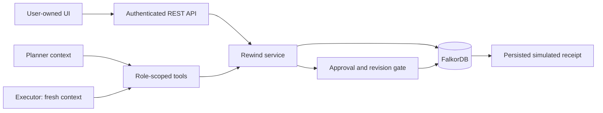

# Rewind: backend implementation and demo plan

Updated: 15 October 2026. Backend and agent tooling are implemented. The user owns the UI and final video. No frontend assets are built.

The original product-wide plan is preserved in [docs/product-plan-original.md](docs/product-plan-original.md). This plan describes the delivered backend, its verification, integration contracts, signed-in Codex transport, and video handoff.

## 1. Outcome and delivered scope

**Correct one bad memory across your agents without deleting everything they learned.**

Rewind uses FalkorDB to store sources, supported semantic/procedural memory, agent conversations, handoffs, tasks, proposed actions, approvals, repair operations, events, and simulated receipts. An operator revokes a source; unsupported descendants are withdrawn, independent support survives, old proposals become stale, and affected work can resume in fresh contexts with a reviewed correction.

| Component | Delivery state |
| --- | --- |
| Graph memory, AND/OR support, provenance | Implemented |
| Revocation, selective repair, idempotent recovery | Implemented |
| Typed facts, candidates, review, atomic corrections | Implemented |
| Planner/executor contexts, durable episodes/handoff | Implemented |
| OpenAI-compatible tool adapter | Implemented and protocol-tested; real inference needs credentials |
| Signed-in Codex CLI adapter | Implemented; uses the existing ChatGPT login without a model API key |
| Real Codex HTTP workflow | Verified: four live runs, stale-action block, corrected receipt, host restart |
| Scripted agent workflow | Implemented and clearly labeled |
| Approvals, stale-action gate, receipt verification | Implemented |
| Tenant/role isolation and concurrent coordination | Implemented; single backend process |
| REST endpoints and exported OpenAPI for UI | Implemented |
| Docker packaging, setup, tests, evaluation | Provided; verification saved in artifacts |
| UI renderer and final recorded video | User/UI team |
| MCP, cloud hosting, broad document ingestion | Future work; no delivery claim |

The scenario is fictional procurement with a simulated ledger. Rewind does not automatically determine truth, erase stale text from an existing LLM context, or reverse completed external effects.

## 2. Stack and modules

Python 3.11+ (tested 3.13.1), FastAPI/Pydantic, Redis client, OpenAI SDK, and one Uvicorn worker. FalkorDB is pinned to `falkordb/falkordb-server:v4.20.7`. Runtime versions are in `requirements.lock`; local/test versions are in `uv.lock`.

| File | Responsibility |
| --- | --- |
| `rewind/config.py` | Environment and server-owned identity/tenant mapping |
| `rewind/contracts.py` | Strict API, tool, and procurement contracts |
| `rewind/graph.py` | Parameterized graph writes/snapshots/descendant queries |
| `rewind/memory.py` | Grounded support, conflicts, expiry, provenance |
| `rewind/service.py` | Tasks, repair, revisions, corrections, approvals, receipts |
| `rewind/agents.py` | Separate bounded tool conversations and dispatcher |
| `rewind/codex_cli.py` | Structured decisions through signed-in `codex exec`; no credential extraction |
| `rewind/app.py` | REST, authentication, CORS, readiness, startup recovery |
| `rewind/demo.py` | Fictional data, direct CLI story, verification |
| `scripts/api_demo.py` | Complete story over the running HTTP endpoints |
| `scripts/init_env.py` | Private local identities without overwriting .env |
| `scripts/run_codex_backend.py` | Host API launcher using the existing Codex login |
| `scripts/evaluate.py` | Controlled memory-service baseline evaluation |
| `tests/` | Real database/API/race/recovery and SDK protocol checks |
| `docs/`, `artifacts/` | Integration documentation and actual verification results |

## 3. Architecture



FalkorDB is authoritative; there is no relational/JSON fallback executor. Fixture files define fictional inputs, not hidden ground truth during repair. Writes serialize per tenant under a process-local lock. Provider calls and human approval waits happen outside the lock. Do not use multiple backend workers or a separate writer process against the same tenant while the API is running.

## 4. Graph and memory contracts

Typed labels: Source, Memory, Justification, Run, Episode, Task, Action, Approval, Repair, Event, Receipt, and TenantState. Record is the common identity label. Payloads are canonical JSON; lineage, retrieval, effect dependencies, and handoffs are real graph relationships.

The main support path is Source → INPUT_TO → Justification → SUPPORTS → Memory. A memory can feed another justification, creating multi-hop derivations. Every input in a justification is required (AND); any complete independent justification can support the memory (OR). Cycles and self-support are rejected before mutation. Copies retain transitive support.

READ_BY records a returned memory revision and potentially exposed run. REQUIRED_BY binds server-resolved dependencies to an action. HANDED_OFF_TO records independent agent sessions. Episodes preserve messages/results; events use server-owned sequence cursors. Retrieval indicates possible exposure, not reconstruction of hidden reasoning.

Memory values/source versions are immutable. A correction creates a new reviewed source/fact, optionally superseding an already-withdrawn memory of the same subject/predicate. Both new records commit together. Agent fact proposals remain candidates until operator review. Agent plans must agree with current typed supplier/invoice facts and observed revisions.

Procedures carry applicability/expiry and a verified simulated receipt. The old fixture procedure is explicitly labeled historical; new procedures are learned from unrecalled committed receipts. Affected support revisions change even when alternatives preserve the value; unrelated revisions remain unchanged.

## 5. Repair and execution behavior

1. Operator submits source, reason, idempotency key.
2. Persist Repair and tenant repairing marker before support changes.
3. Revoke source and query actual FalkorDB descendants.
4. Evaluate complete grounded support; retain valid alternatives.
5. Update affected revisions idempotently using stored baseline/repair IDs.
6. Mark pending actions stale, advance task generations, require fresh runs.
7. Preserve committed receipts and flag affected effects for review.
8. Read back invariants; reopen tenant only after completion.

Startup/manual recovery resumes incomplete repairs. Repairing state prevents usable retrieval, approvals, and execution; graph/audit inspection remains available. Separate queries are not advertised as a multi-query transaction.

Execution re-resolves invoice ownership, amount/currency, supplier name/routing, required revisions, grounded evidence, task generation, conflicts, and exact operator approval. The agent cannot omit a required dependency or self-approve. Receipt/effect terminal state is one graph write; failed-write rollback is checked on the pinned image. Retry returns the same receipt; another task/key cannot repay the same supplier/invoice. These are local simulated effects, not real banking or distributed exactly-once claims.

## 6. Setup

```powershell
uv --cache-dir .uv-cache sync --extra test --frozen
uv run python scripts/init_env.py
codex login status
docker compose stop backend
docker compose up -d falkordb
uv run python scripts/run_codex_backend.py
```

Private `.env` contains random scoped backend tokens. Authentication resolves tenant/role on the server. `AGENT_PROVIDER=codex_cli` selects the host's signed-in Codex account for live runs. If login status is unavailable, run `codex login` once. Leave `MODEL_NAME` blank for the CLI default; an explicit model must be available to that account. `CODEX_COMMAND` can name the executable path; `CODEX_TIMEOUT_SECONDS` bounds each decision. No model API key is required. Run this backend on the signed-in host; the default Docker image does not include the Windows executable/login.

The Codex adapter runs one ephemeral structured decision per turn in an isolated directory with a read-only sandbox and native execution/app/plugin/delegation tools disabled. Rewind validates tool arguments and performs all graph/approval/effect operations. It restores only the current run's persisted conversation, records token usage, and preserves separate planner/executor contexts. Application identity/API keys are stripped from the subprocess environment; authentication and token refresh remain owned by Codex. Subscription access/limits apply.

The API-key alternative remains `AGENT_PROVIDER=openai` with `MODEL_API_KEY`, `MODEL_NAME`, and `MODEL_BASE_URL`. That endpoint must support Chat Completions function tools and `parallel_tool_calls=false`. This SDK transport is protocol-tested without a provider API key. Scripted mode remains deterministic and explicitly labeled.

Docker Compose can package/run both services with `docker compose up --build -d`. Ports are loopback-bound. FalkorDB's entrypoint takes `REDIS_ARGS`, which enables AOF/appendfsync always and writes to its mounted `/var/lib/falkordb/data` directory. Verify actual settings after startup.

For an existing snapshot-only database, migrate/enable logging before changing startup persistence mode: a fresh AOF can otherwise take precedence over old snapshots. The initial synthetic development fixture was reseeded after this mode switch. New installs start with AOF enabled.

## 7. API contract for the UI team

[docs/api.md](docs/api.md) contains exact inputs, outputs, roles, status/error handling, pagination, and the complete demo sequence. [docs/openapi.json](docs/openapi.json) is the exported schema. Local `/docs` is autogenerated API reference, not an application frontend.

| Surface | Purpose |
| --- | --- |
| `/health`, `/ready`, `/api/me`, `/api/state` | Service/tenant/role/model readiness |
| `GET /api/graph`, `/api/events?after=...` | Renderer data and persisted timeline |
| Memory list/provenance and sources/tasks/runs/actions/repairs/receipts | Inspect state and evidence |
| Records and run episodes | Details and durable conversations |
| Source/memory creation, supports, review | Operator admission and candidate review |
| Source revocation preview/revoke | Explain/apply selective repair |
| Corrections and repair recovery | Reviewed replacement and interrupted work |
| Task creation and run start | Planner/executor coordination |
| Run continue/tools | Resume approval-paused work or call scoped tools |
| Action approve/execute/learn-procedure | Exact approval, guarded effect, verified procedure |
| Demo seed/reset | Explicit fictional tenant setup |

Run start/continue returns 202; poll persisted run/events for progress. Approval is a real paused state. Reset requires a registered demo-marked tenant, explicit confirmation, and no active agent. Counts/statuses/receipts must come from the backend, not UI animation.

Errors use `{error:{code,message,details}}`; malformed inputs return 422 validation details. Important UI states include STALE_ACTION, STALE_MEMORY, STALE_RUN, MISSING_APPROVAL, CONFLICTING_FACT, REPAIR_IN_PROGRESS, MODEL_NOT_CONFIGURED, and DATABASE_UNAVAILABLE.

## 8. Implementation milestones

- [x] Typed graph/state, isolated identities, real database setup.
- [x] AND/OR grounding, provenance, cycles, revisions, selective repair.
- [x] Persistent repair marker, idempotent recovery, no-fallback errors.
- [x] Separate persisted runs, messages, tasks, generations, and handoffs.
- [x] Exact approvals, effect gate, simulated receipts, retries.
- [x] Candidate review and atomic corrections.
- [x] OpenAI-compatible bounded tool loop and scripted demo mode.
- [x] REST/CORS/OpenAPI handoff with no frontend assets.
- [x] Actual SDK transport/continuation through a protocol fixture.
- [x] Codex CLI transport through the signed-in ChatGPT account; protocol fixture and real response probe.
- [x] Real-database behavior suite and controlled evaluation.
- [x] Setup, API, architecture, limits, and recording documentation.
- [x] Complete signed-in Codex live workflow over HTTP and verify host restart persistence.
- [ ] Rehearse the final UI/video on the signed-in host; no model API key needed.
- [ ] User/UI team connects renderer/operator controls.
- [ ] User records/publishes final video and submission links.

Container/API/persistence verification results are stored in artifacts. Do not substitute a scripted or protocol-fixture result for the real-model milestone.

## 9. Verification and evaluation

```powershell
uv run python -m pytest --junitxml=artifacts/tests.xml
uv run python scripts/evaluate.py
```

27 tests passed against actual FalkorDB during implementation. The suite covers AND/OR/multi-hop repair, copied support, cycles, conflicts, procedure expiry, omitted dependencies, exact approval, stale writes, duplicate effects, invoice ownership, tenant isolation, 100 episode writes from 50 callers, revocation/execution races, partial-write recovery, API integration, SDK protocol handling, and Codex structured decisions/environment isolation.

Evaluation: 20 small labeled fixtures, three controlled memory-service variants, 60 measurements. Delete-only retains stale derivatives; wipe-all loses valid memory; Rewind selectively withdraws unsupported records while preserving valid knowledge in these fixtures. This is not a commercial-product benchmark or real-world accuracy claim. Case-level sizes, latencies, and persistence settings are in [artifacts/evaluation.json](artifacts/evaluation.json).

Durability proof records graph/receipt IDs, forces a database container restart, and compares persisted state afterward. A browser refresh is not a process restart. Keep the named volume; do not run an unscoped database wipe.

The earlier [packaged-backend verification](artifacts/docker-verification.json) covers the scripted containerized story, forced database restart (211 records/one receipt), and backend restart (213 records). The latest [verification](artifacts/verification.json) covers real signed-in Codex inference: four live runs, 23 structured decisions, stale-action rejection, one verified corrected simulated receipt, and exact graph preservation across a host backend restart (220 records, 124 edges). The [live HTTP transcript](artifacts/codex-live-demo.json) contains the actual responses. This is one real-model fixture workflow, not a model-quality benchmark.

## 10. Backend-only demo

With the server running:

```powershell
uv run python scripts/api_demo.py --mode scripted --reset
```

The script privately resolves the local operator token, drives actual HTTP endpoints, and saves [artifacts/api-demo.json](artifacts/api-demo.json). With the signed-in Codex host launcher, run `uv run python scripts/api_demo.py --mode live --reset --output artifacts/codex-live-demo.json` for actual inference. Direct CLI stories are for a stopped backend to avoid competing writers.

1. Seed accepted incorrect onboarding, independent purchase order, unrelated terms.
2. Planner reads evidence, saves a supported plan, and hands off.
3. Fresh executor retrieves shared memory and proposes the old effect.
4. Operator approves exact payload but leaves it unexecuted.
5. Preview/revoke the incorrect source with an audit reason.
6. Old execution returns 409 STALE_ACTION; no old receipt exists.
7. Show independent name support and unrelated invoice/terms retained.
8. Admit reviewed routing correction as a new memory version.
9. Start fresh planner/executor for the changed task generation.
10. Approve/continue corrected work; verify one correct simulated receipt.
11. Learn a supported procedure from its verified receipt.

## 11. Video/submission handoff

| Proposed time | Evidence |
| --- | --- |
| 0:00–0:20 | Concrete wrong-memory problem; historical/synthetic labels |
| 0:20–0:50 | Planner reads, evidence, saved plan, handoff |
| 0:50–1:10 | Fresh executor run and frozen old proposal |
| 1:10–1:35 | Preview, revocation, actual multi-hop repair report |
| 1:35–1:55 | Stale rejection and absence of old receipt |
| 1:55–2:15 | Independent evidence survives |
| 2:15–2:45 | Reviewed correction, fresh runs, new approval/verified receipt |
| 2:45–3:00 | Persistence/isolation proof and repository/setup links |

Three minutes is a target, not an asserted event video limit. Label live versus scripted inference. All company/payment data is fictional. A seeded accepted mistake is not a demonstrated live jailbreak.

Submission package: public repo, README/setup, graph model/queries, video, track selection, deployment or complete local instructions, AI disclosure, attribution, measured evidence. The user owns final UI/recording/publication. Backend endpoints and recording steps are provided.

## 12. Limits and next steps

Snapshots are bounded at 10,000 records/20,000 edges. Writes serialize per tenant in one process. Truth/admission is operator-controlled. Procedures support one workflow version. Runs that read affected evidence restart conservatively. MCP, cloud deployment, distributed coordination, and full bitemporal querying are not claimed.

Next: rehearse the signed-in Codex HTTP flow → integrate UI against OpenAPI → record demonstrated outcomes → verify submission links.

References: [API](docs/api.md), [architecture](docs/architecture.md), [queries](docs/queries.md), [evaluation](docs/evaluation.md), [recording](docs/demo.md), [AI use](docs/ai-use.md), [MemoryGraft](https://arxiv.org/abs/2512.16962), [MemSecBench](https://arxiv.org/abs/2607.27080), [OpenAI tools](https://developers.openai.com/api/docs/guides/function-calling), [FalkorDB persistence](https://docs.falkordb.com/operations/durability/persistence), [event rules](https://www.wemakedevs.org/hackathons/falkordb/rules).
